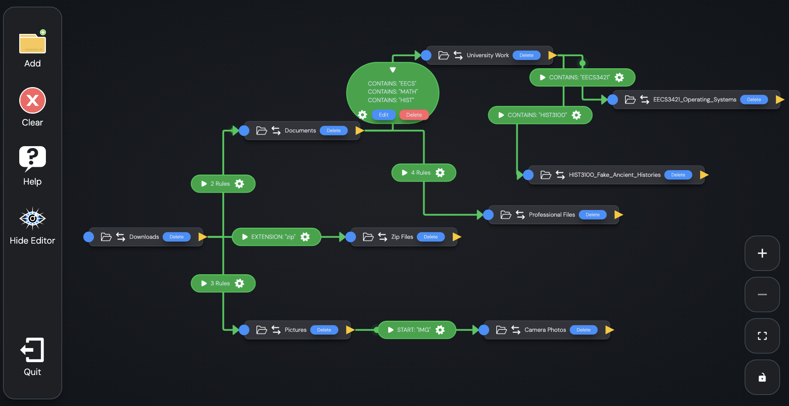

<h1>Lettertray</h1>

Tech Stack: TypeScript, SQL, React.js, Electron.js, SQLite, React Flow, React Router

An Electron JS application that automatically sorts through a user's files & directories based on user instruction. Users can create their own parameters through an interactive, animated flowchart interface.

<h2>Features</h2>
    <ul>
        <li>Fully interactive, animated flowchart interface with drag-and-drop mechanics</li>
        <li>Autonomous file/directory sorting that accounts for newly-added files and old files alike</li>
        <li>Maintains a history log of all file-relocation events via a native SQLite database, allowing users to track where their files go</li>
        <li>Extensive error handling that accounts for deleted folders, conflicting rules, et cetera, for a seamless experience </li>
    </ul>

<h2>Preview Images</h2>
    

<h2> Checklist</h2>

 [DONE] Flowgraph: Handle deleting edges (lines) so that they reflect on the user's organization rules

 Flowgraph: Handle deleting nodes so that they reflect on the user's organization rules 

Create an edit menu for configuring the path of each node

Create a toggle for automatic sorting on a specific rule or node [COMPLETE]

Create a formal 'Clear All' button containing a Popup asking for user confirmation [COMPLETE]

Reconfigure the Keyword selection for each rule to have four different configurations: the progrma could look for the keyword at the start only, end only, anywhere in the filename, or search for specific extensions (e.g. .txt, .doc)

Optimize program to only save at select intervals, rather than at every change [COMPLETE]

Create a delete button for each edge/rule [COMPLETE, 2026/09/16]

Create a delete button for each node / folder being watched [COMPLETE]

Allow each edge to have more than one rule, or be able to filter two types of files (e.g. .png and .jpg) [COMPLETE]

Implement an Edit Button to Edges (Last core feature)

Create a brief Help section

